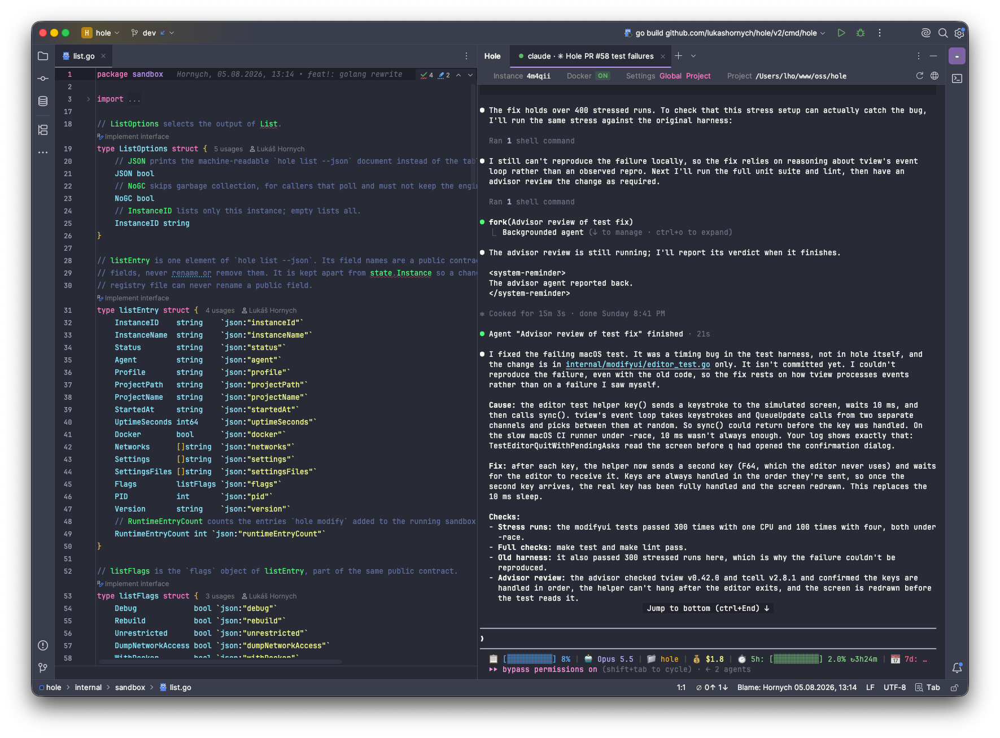
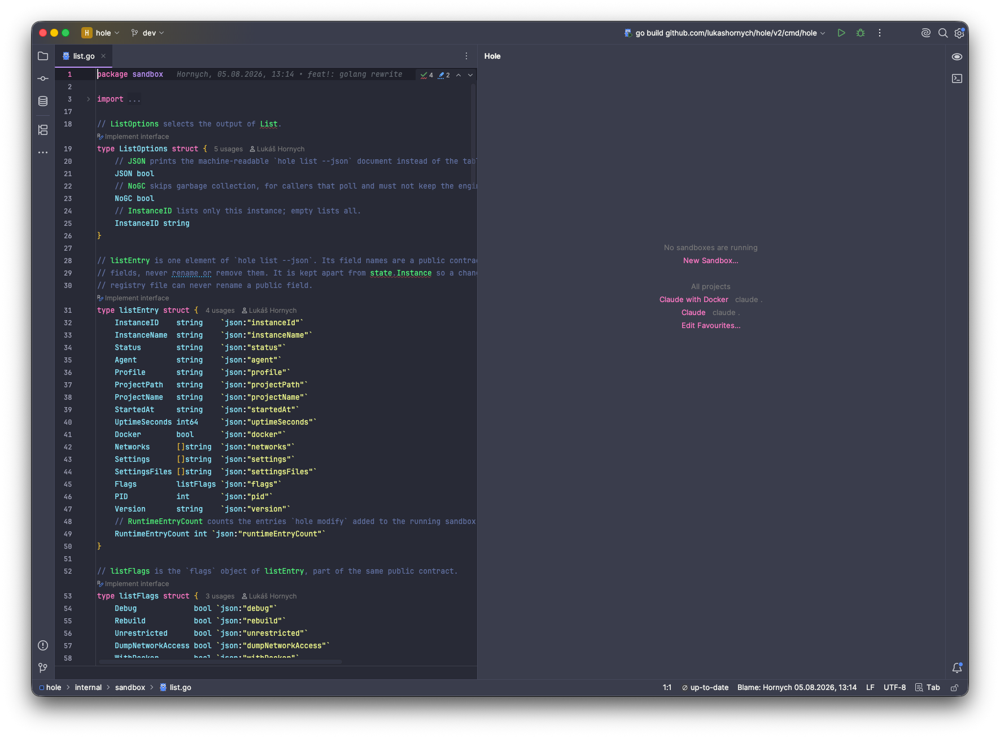
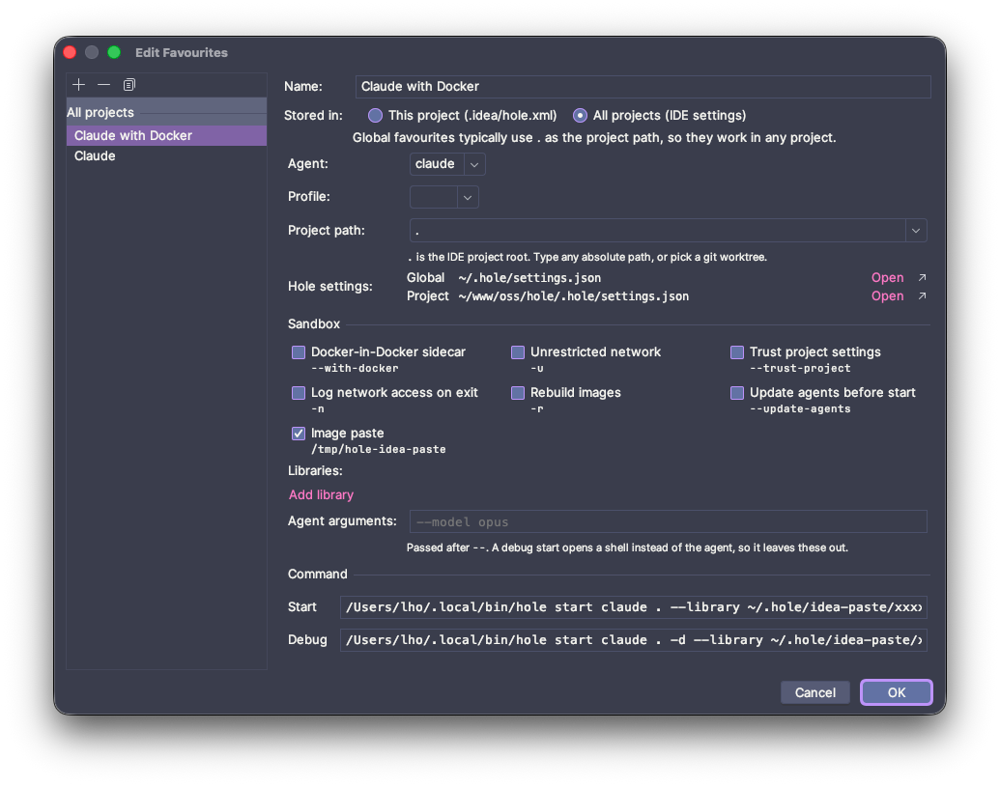

# Hole plugin for JetBrains IDEs

<table>
  <tr>
    <td width="50%"></td>
    <td width="50%"></td>
  </tr>
  <tr>
    <td align="center"><em>Start page with favourites</em></td>
    <td align="center"><em>Sandbox options and favourites</em></td>
  </tr>
</table>

Start, manage and switch between [Hole](https://github.com/lukashornych/hole) sandboxes directly from IntelliJ IDEA
and other JetBrains IDEs.

## What is it and why?

[Hole](https://github.com/lukashornych/hole) runs AI agents — Claude Code, Gemini CLI, Codex CLI or your own — in
isolated Docker sandboxes, with network access limited to what you allow and project files mounted with
exclusions. It is a CLI tool: you start a sandbox with `hole start claude .` in a terminal.

Doing that from the IDE's Terminal works, but it is clumsy: you retype flags, juggle several terminal tabs for
several agents, cannot tell at a glance which sandbox runs where, and have to remember Hole commands to look at the
network policy. This plugin gives Hole a home in the IDE:

- a **Hole tool window** where each tab is one running sandbox with a real terminal, titled by what the agent is
  working on,
- a **New Sandbox** dialog with every `hole start` option and a live command preview,
- **favourites** — saved sandbox configurations for this project or all projects, one click to start,
- a **sandbox header** with the instance, Docker-in-Docker, the settings files in use, *Restart* and *Network…*,
- a **Network** window to allow blocked domains while the sandbox runs (`hole modify` with a GUI),
- **image paste** — paste a screenshot into the agent with `Cmd+V` / `Ctrl+V`, although the sandbox cannot read
  your clipboard,
- clickable file paths in the agent's output, and clean stopping of sandboxes when a tab or the IDE closes.

The plugin does not replace Hole or change how it isolates the agent: it runs `hole` exactly as you would, and
Hole's settings files remain the place to configure sandboxes.

## Requirements

- IntelliJ IDEA 2025.2 or newer, or another JetBrains IDE built on the same platform (with the bundled Terminal
  plugin)
- [Hole](https://github.com/lukashornych/hole#installation) **2.6.0 or newer** and what it needs (`docker` or
  `podman` with compose)
- an IDE running on macOS or Linux — the plugin signals Unix process groups and does not support IDEs on Windows

## Installation

The plugin is not on the JetBrains Marketplace yet.

1. Download `jetbrains-ide-hole-plugin-<version>.zip` from the latest
   [GitHub release](https://github.com/lukashornych/jetbrains-ide-hole-plugin/releases).
2. In the IDE, open *Settings › Plugins*, click ⚙ and choose *Install Plugin from Disk…*, then select the ZIP.

The plugin finds `hole` on the `PATH` of your shell or in `~/.local/bin`. If it is somewhere else, set its path in
*Settings › Tools › Hole*.

## Usage

Open the **Hole** tool window at the bottom of the IDE and click *New Sandbox…* (or `+` in the tab strip). Pick the
agent, an optional profile and the project path — `.` is the IDE project, and git worktrees of the project are
offered in the dropdown — tick the sandbox options you need and press *Start*. *Start in Debug Shell* opens a shell
in the sandbox instead of the agent.

*Save as Favourite…* stores the configuration; favourites appear on the tool window's start page and in the dropdown
next to `+` (Shift+click starts one in Debug Shell). A favourite does not store the project path: it starts in the
IDE project, or — when the project has git worktrees — in the project or a worktree you pick from a short list.
Project favourites are stored in `.idea/hole.xml`, so they can be shared through version control.

Closing a tab stops its sandbox. When Hole fails to start, the tab stays open with Hole's output, so you can read the
error.

The full behaviour is described in the [specification](documentation/developer/specification.md).

## Contributing

Contributions are welcome — bug reports, ideas and pull requests alike. Pplease open an issue first so we can agree on the approach.

- **Developer documentation** starts at [documentation/developer/index.md](documentation/developer/index.md): how
  to build and test, the architecture, conventions and recipes for common changes.
- **Build and test:** `./gradlew test` runs all tests against a fake `hole` script — no Docker needed.
  `./gradlew runIde` starts an IDE with the plugin for trying it out.
- **Branches:** `dev` is the development branch; create your branch from `dev` and open the pull request against
  it. `main` holds released versions only — every push to it publishes a release.
- **Commits** follow [conventional commits](https://www.conventionalcommits.org/) (`feat: …`, `fix: …`), because the
  release version is derived from them.
- **Every bug fix comes with a regression test**, and behaviour changes update the
  [specification](documentation/developer/specification.md).
- Decisions whose reasoning must outlive the change are recorded in [documentation/adr](documentation/adr/README.md).

## License

Licensed under the [Apache License 2.0](LICENSE), like [Hole](https://github.com/lukashornych/hole).
